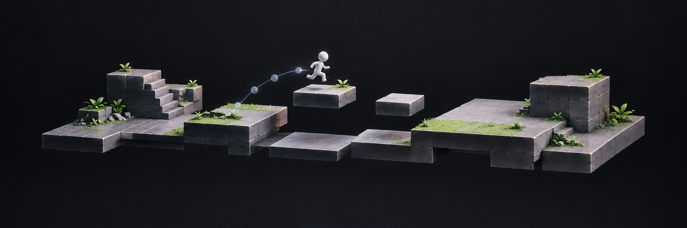

## 🎮 Behind the experience

I share gameplay code samples and prototypes here, with implementation notes on gameplay logic, state transitions, and runtime behavior.

Full project stories live on my [portfolio](https://phillipeaam.github.io).

---

[💼 LinkedIn](https://www.linkedin.com/in/phillipe-augusto/) · [🎮 itch.io](https://phillipeaam.itch.io/) · [▶ YouTube](https://www.youtube.com/channel/UCP1HCs5ptr5UJ30aILVTWAA)
